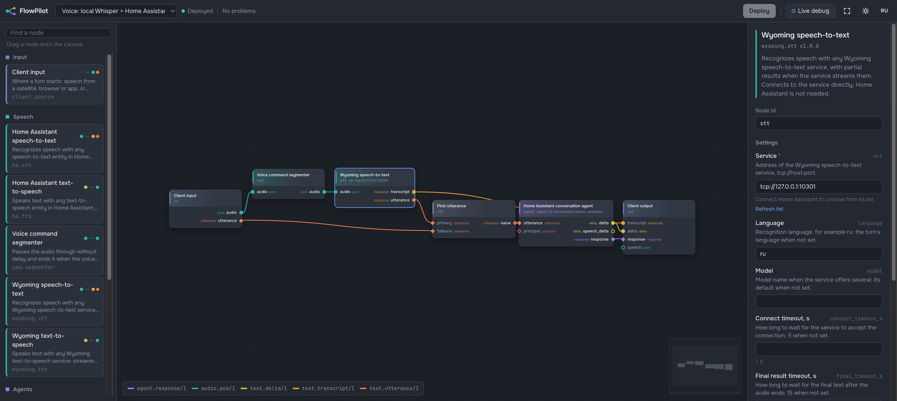

<p align="center">
  <picture>
    <source media="(prefers-color-scheme: dark)" srcset="https://raw.githubusercontent.com/darkdarin/flowpilot/main/custom_components/flowpilot/brand/dark_logo.png">
    
  </picture>
</p>

# FlowPilot for Home Assistant

[](https://github.com/darkdarin/flowpilot/releases)
[](https://github.com/darkdarin/flowpilot/actions/workflows/ci.yml)
[](https://github.com/darkdarin/flowpilot/actions/workflows/release.yml)
[](https://hacs.xyz/)
[](https://www.home-assistant.io/)


[](LICENSE)

Build what happens between a satellite hearing a command and Home Assistant answering it, as a
**graph** in a visual editor in the Home Assistant sidebar. Instead of the fixed
`speech-to-text → conversation agent → text-to-speech` chain of Assist, you wire nodes yourself:
pick any speech-to-text and agent, put a voice activity detector in front of Whisper, split and
join branches, and watch every turn flow through the graph live.

> Early version (0.1). It works inside Assist today, with any satellite; speaker identification,
> LLM agents and tools are on the way.

<p align="center"></p>

## What you get

- **A graph editor in the sidebar.** Nodes for Home Assistant speech-to-text, text-to-speech and
  conversation agents, any [Wyoming](https://github.com/OHF-Voice/wyoming) speech service, a voice
  command segmenter and logic. Wires are colored by the data they carry and only connect where the
  types match. Light and dark themes, English and Russian.
- **Safe changes.** Every edit is saved as a draft and checked; **Deploy** switches the running
  graph without a restart, and a turn in progress finishes on the old version.
- **Live debug.** See each node's status and timing, how much data went over every wire and where
  a turn failed. Put a **Debug probe** next to any output to hear the audio or read the text that
  went through; pick a turn and it shows right on the node. Probes run only while live debug is on
  (greyed out otherwise), and recordings stay on your machine and out of Home Assistant backups. No
  satellite needed to try a graph: in live debug the **Client input** node takes typed text, a
  microphone recording or an audio file, and a **Fixed answer** node stands in for an agent
  (`echo: {text}` repeats what was said).
- **Works with any satellite.** ESPHome and Voice PE, Wyoming satellites, VoIP and third-party
  ones (such as [Yandex Quasar](https://github.com/darkdarin/yandex-quasar)): FlowPilot plugs into
  Assist as its speech-to-text engine and conversation agent.
- **Choose from lists, not ids.** Settings that name an entity or a Wyoming service offer what Home
  Assistant has, with your own value one click away; a Wyoming service's models, languages, voices
  and speakers come from the service itself. A deployed graph that refers to something you removed
  raises a repair issue.

## What you need

- Home Assistant OS or Supervised, **2026.10 or newer** (the app runs on aarch64 and amd64, for
  example a Raspberry Pi 5).
- For voice: a satellite and a speech-to-text service, either a Home Assistant STT entity (cloud,
  Whisper and so on) or a Wyoming service FlowPilot can reach.

## Installation

### Step 1. Install the FlowPilot app

The app is the FlowPilot runtime with the graph editor.

[](https://my.home-assistant.io/redirect/supervisor_addon/?addon=988b5cb9_flowpilot&repository_url=https%3A%2F%2Fgithub.com%2Fdarkdarin%2Fflowpilot)

1. Press the button: Home Assistant offers to add the repository and opens the app page.
   By hand: **Settings → Apps → App Store → ⋮ → Repositories**, add
   `https://github.com/darkdarin/flowpilot`, then find **FlowPilot** in the store.
2. Install the app and start it. **FlowPilot** appears in the sidebar: that is the editor, already
   signed in through Home Assistant.

### Step 2. Install the integration

[](https://my.home-assistant.io/redirect/hacs_repository/?owner=darkdarin&repository=flowpilot&category=integration)

1. Press the button. By hand on Home Assistant 2026.11 and newer: **Settings → Marketplace → Add
   from link**, enter `darkdarin/flowpilot` (type **Integration** if asked). On 2026.10: **HACS →
   ⋮ → Custom repositories**, add `https://github.com/darkdarin/flowpilot` with type
   **Integration**.
2. Install **FlowPilot** and **restart Home Assistant**.
3. **Settings → Devices & services** shows the discovered **FlowPilot** (the app announces itself).
   Press **Add** and confirm: no address or token needed. **Add integration → FlowPilot** finds the
   app the same way.

### Step 3. Make an assistant use FlowPilot

1. **Settings → Voice assistants → Add assistant** (or edit one).
2. Set **Speech-to-text** and **Conversation agent** to the same FlowPilot graph: every deployed
   graph has its own pair named after it (`stt.flowpilot_<graph>`, `conversation.flowpilot_<graph>`).
   **FlowPilot Speech-to-text** and **FlowPilot Agent** follow the main graph, the one starred in
   the editor. Text-to-speech stays your usual one: Home Assistant speaks the answer.
3. Pick this assistant on the satellite's device page. Different assistants can run different
   graphs, for example one per room.

Try it in the Assist chat first: the starter graph `main` answers typed text with the Home
Assistant agent.

### Step 4. Add voice to the graph

The starter graph has no speech-to-text yet. Open **FlowPilot** in the sidebar and drag in:

1. **Home Assistant speech-to-text** (pick your STT entity) or **Wyoming speech-to-text** (your
   service's `tcp://host:port`). For Whisper and most Home Assistant STT entities put a **Voice
   command segmenter** between **Client input** `audio` and the speech-to-text node.
2. A **First utterance** node: connect the speech-to-text `utterance` to `primary` and **Client
   input** `utterance` to `fallback`, then its `value` to the agent's `utterance` (an input takes one
   wire, so this replaces the starter's direct wire). Voice and typed turns both work this way.
3. The speech-to-text `transcript` to **Client output** `transcript`, so the satellite shows what
   it heard.

Press **Deploy** and say something to the satellite; **Live debug** shows the turn.

## Configuration

### App options

On the **Configuration** tab of the app. Usually there is nothing to change.

| Option | What for |
|---|---|
| `log_level` | how much the runtime writes to the app log (`debug` for troubleshooting) |
| `dev_nodes` | nodes for testing without speech services: a fixed-phrase speech-to-text and an echo agent |

### Data

Graphs, their drafts and the runtime config live in the app's data folder and are part of Home
Assistant backups. Each deployed graph keeps its previous version as a backup.

### Clients outside Home Assistant

The runtime also serves other clients: the browser test client at `/`, `POST /api/turn` and the
WebSocket protocol. Map port `8765` in the app's **Network** settings to reach it from other
machines; such clients need the access token from the runtime's `token` file.

## If something does not work

- **FlowPilot is not discovered, or the integration asks for an address and a token.** The app
  announces itself on every start: its **Log** should have `announced to Home Assistant as …`.
  Restart the app, then add the integration again. The address and token form is only for a runtime
  outside Home Assistant OS (Docker).
- **The satellite hears you but nothing happens.** Open **Live debug** in the editor and speak: a
  red node shows the step that failed and why. Assist's own debug view is in **Settings → Voice
  assistants → ⋮ → Debug**.
- **The assistant says "No answer: a step of the voice flow failed."** A node of the graph failed,
  most often an entity that no longer exists; check **Settings → System → Repairs** and the editor.
- **A graph refers to an entity you removed.** Home Assistant shows a repair issue naming the graph
  and the node; pick another entity in the editor and press **Deploy**.

## How it works

```
satellite ──> Assist ──> FlowPilot STT entity ─┐            ┌─> FlowPilot conversation entity ──> Assist TTS
                                               │            │
                                               └─> FlowPilot app: your graph ──> Home Assistant STT, TTS,
                                                    (runtime + editor)            agents (host operations)
```

The integration (`custom_components/flowpilot`) gives Assist a speech-to-text engine and a
conversation agent that hand the audio to the FlowPilot runtime and take its answer back; both
stages of one Assist run are linked into one FlowPilot turn. The runtime (the app, `addon/`)
executes the graph and calls back into Home Assistant for its STT, TTS and agents. The core does
not depend on Home Assistant, so the runtime also runs on its own:

```sh
docker run -d --name flowpilot -p 8765:8765 -v flowpilot-data:/data ghcr.io/darkdarin/flowpilot
docker exec flowpilot cat /data/token     # token for the editor and the integration
```

## Development

| Path | What |
|---|---|
| `packages/flowpilot-sdk` | Plugin SDK: payload types, ports, node interface |
| `packages/flowpilot-core` | Runtime: graph validation and execution, plugin conformance kit |
| `packages/flowpilot-server` | Runtime server, client protocol, editor API |
| `plugins/` | Node plugins (Wyoming, voice activity detection) |
| `custom_components/flowpilot` | Home Assistant integration (installed via Marketplace/HACS) |
| `ha-integration/` | Test environment for the integration (pinned Home Assistant) |
| `addon/` | Home Assistant app |
| `editor/` | Graph editor (Vue 3 + Vue Flow) |

```sh
uv sync && uv run pytest                  # runtime; see CONTRIBUTING.md for all checks
cd editor && npm ci && npm run dev        # editor against a local runtime
```

Writing a node plugin, checks and conventions: [CONTRIBUTING.md](CONTRIBUTING.md). Releases and
rules for coding agents: [AGENTS.md](AGENTS.md). Architecture decisions and research are kept in
the owner's Notion.

## License

[Apache License 2.0](LICENSE)
